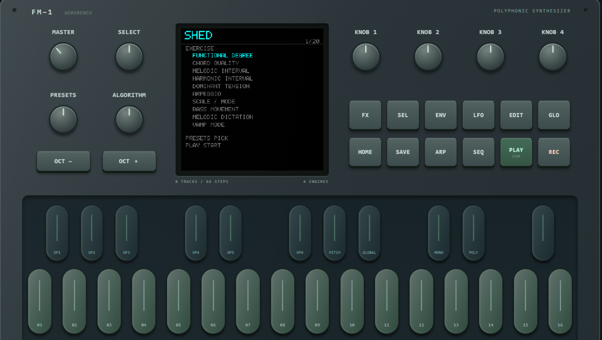

# Shed

[](LICENSE.md)

[English](README.md) · Español · [简体中文](README.zh-CN.md)

Un modo de entrenamiento auditivo de jazz para el sintetizador [M-VAVE FM-1](https://www.m-vave.com/products/fm-1), construido sobre [FM1 Open](https://github.com/m-vave/fm1_open).

Entra en Shed con **HOME+SCL** y practica grados funcionales, calidades de acorde, intervalos melódicos y armónicos, tensiones de dominante, arpegios, escalas/modos, movimiento del bajo, dictado melódico y (en el modo Vamp) rondas de oído, directamente en el dispositivo — sin app, sin ordenador. Las sesiones adaptan su dificultad a tu racha de aciertos y usan repetición espaciada para hacer reaparecer lo que más fallas. El **modo Vamp** repite una progresión de acordes (bajo + acompañamiento) mientras improvisas sobre ella, con guía por LEDs en las teclas y una ronda de "oído" que te pregunta sobre lo que está sonando.



Consulta [`SHED_SPEC.md`](SHED_SPEC.md) (en inglés) para el diseño completo: el núcleo teórico, el conjunto de ejercicios, el modo Vamp, las pantallas del dispositivo y el registro de desarrollo fase por fase.

¿Quieres probar los ejercicios sin tener un FM-1 a mano? [**Shed Web**](https://shed-web.vercel.app) es una versión para navegador que reutiliza el mismo núcleo teórico y la misma pedagogía — [código fuente](https://github.com/Luisnvb/shed-web).

```
.\tools\Build-Web.ps1 -LocalPreview   # compila el simulador de navegador
.\tools\Test-Shed.ps1                 # ejecuta la batería de tests de Shed
```

Shed vive por completo bajo [`app/shed/`](app/shed/), con un gancho de 2 líneas en `app/screen.c`; no modifica el resto del firmware. A continuación, el README original de FM1 Open sobre el que se construye este proyecto.

---

# FM1 Open V14

[English](README.md) · Español · [简体中文](README.zh-CN.md)

8 pistas, 8 ranuras de muestras, 16 demos de FX; SDK binario incluido.

[Workbench y kit de desarrollo](https://open.m-vave.com/fm1-workbench) · [Foro oficial](https://forum.m-vave.com)

Usa el workbench para actualizar el firmware, previsualizar el instrumento y gestionar proyectos, muestras y voces DX7. Selecciona "Source + SDK" para descargar el kit de desarrollo correspondiente a la versión publicada online. Haz copia de seguridad de proyectos, voces y muestras antes de actualizar, y mantén el dispositivo encendido durante las escrituras.

## Novedades de V14

- **Librería DX7:** 128 voces en cuatro grupos de 32, con las voces de fábrica originales V15 del M-VAVE FM1 y su orden. Los bancos de usuario guardados tienen prioridad. Se admite la importación/exportación SysEx de una sola voz DX7 y de bancos de 32 voces; los parámetros de extensión no se gestionan. Cambiar la librería no modifica los patches ya guardados en proyectos.
- **Roles de pista:** en SEQ **8/8 TRACK ROLE**, K1 selecciona NORMAL, PLAY u OFF; K2 selecciona el canal MIDI de entrada 1–16. PLAY conserva el timbre de la pista y las notas mantenidas entre cambios de proyecto. MUTE/SOLO usan los controles existentes, con grupos de solo independientes para NORMAL y PLAY. Las ediciones de timbre en PLAY no se guardan con los proyectos: exporta un archivo de timbre, o guarda las voces DX7 en la librería independiente.
- **Grabación paso a paso:** con la pista en NORMAL, pulsa REC detenido y toca notas. Soltar todas las teclas pulsadas avanza al siguiente paso, incluyendo DRUM 808 y SAMPLER. Las notas superpuestas comparten un paso; durante la reproducción, REC graba en tiempo. Las pistas PLAY son para interpretación en vivo y no graban notas.
- **Tempo y delay:** el tempo interno es de 30–300 BPM. Tap Tempo está disponible en el workbench, con SEQ en la página FX DELAY, o manteniendo HOME mientras se pulsa SEQ en cualquier otro sitio. El delay admite sincronización con el tempo y tiempos fijos de aproximadamente 30–2040 ms.

## MIDI

FM1 acepta entrada MIDI por DIN, USB y BLE, con salida USB/BLE. Los canales de entrada por defecto 1–7 se asignan a las pistas 1–7; el canal 10 se asigna a la pista 8. Cambia cada canal de entrada en TRACK ROLE.

- **5/8 SYNC / LOOP:** selecciona reloj interno o externo, tempo, longitud de loop y entrada de reloj.
- **6/8 MIDI TRACK:** selecciona salida SEQ/ARP LOCAL, BOTH o MIDI, canal de salida, puertos de salida y KEY OUT físico.
- **7/8 MIDI ROUTING:** configura LOCAL, CLK OUT y MIDI Thru. Para monitorizar desde una DAW con Local Off, activa KEY OUT y selecciona los puertos de salida.

Las preferencias MIDI se guardan de forma independiente a los proyectos. El simulador de navegador previsualiza estos ajustes sin enviar MIDI de interpretación a puertos externos; configura el instrumento en su panel. Se admite entrada de MIDI Clock, Start, Continue, Stop y Song Position Pointer. La pérdida del reloj detiene la reproducción sincronizada.

## Actualizaciones y compatibilidad

V13 puede actualizarse a V14. El workbench permite volver a la V15 original y migrar desde firmware de terceros compatible. El protocolo estándar de actualización FM1 sigue disponible. La compatibilidad se ha comprobado con versiones de firmware seleccionadas; no es una garantía para cualquier versión de terceros.

Cambiar de firmware no hace que los formatos de proyecto y de muestras sean intercambiables. Conserva copias de seguridad exportadas para poder revertir. El firmware anterior puede no admitir las preferencias de pista de V14, la librería de voces independiente ni los ajustes de delay sincronizado/extendido.

Para hacer copia de seguridad de la librería de voces independiente, lee y exporta los grupos A–D por separado. Los archivos de proyecto no contienen audio de muestras. Restaura las muestras personalizadas desde su copia de seguridad del banco de muestras; escribir el banco de muestras integrado sustituye las muestras actuales.

Las ocho ranuras de muestras comparten unos 19,55 segundos de almacenamiento nuevo para muestras. Los bancos más grandes existentes se siguen pudiendo leer; puede que haya que hacerles copia de seguridad y reducirlos antes de escribir la librería DX7 independiente.

## Compilación

Requiere Windows x64, PowerShell, `curl.exe` y `tar.exe`. Las compilaciones de firmware requieren el **toolchain de JieLi para Windows 2.5.3**, que incluye PI32v2 clang 4.0.1. [Descarga el instalador 2.5.3 de JieLi](https://jl-update.oss-cn-shenzhen.aliyuncs.com/2.5.3.exe) y sigue la [guía de instalación](https://doc.zh-jieli.com/Tools/zh-cn/dev_tools/dev_env/jl_toolchain.html). Define `FM1_PI32_TOOLCHAIN` apuntando a su carpeta `pi32`, que contiene `bin/clang.exe` (normalmente `C:\JL\pi32`). FM1 sigue usando el target de CPU `r3`.

La compilación comprueba los 22 archivos del toolchain contra `sdk/manifest.json`. Los kits V14 antiguos estaban fijados a la 2.5.2 y rechazan la 2.5.3; actualiza el kit completo de fuente + SDK a la vez, manteniendo activas las comprobaciones del manifiesto. Para esta revisión, el SHA-256 esperado de `pi32/bin/clang.exe` es `d4bc97cf421c1ccc373dd8924ce88720ff7457b3f1478d15df4aeda6ae923bce`.

Para una previsualización web local:

~~~powershell
.\tools\Build-Web.ps1 -LocalPreview
~~~

Para compilaciones de distribución, primero define `FM1_SOURCE_URL` con la URL HTTPS del archivo de fuentes correspondiente, incluyendo tus cambios, licencias y scripts de compilación/instalación. Luego ejecuta:

~~~powershell
.\build.bat --web
$env:FM1_PI32_TOOLCHAIN = 'C:\JL\pi32'
.\build.bat --package
~~~

Para una compilación de firmware local sin una URL de fuente de distribución, ejecuta `./sdk/Build.ps1 -FirmwareOnly -Toolchain 'C:\JL\pi32'`. Una página `tree/main` de GitHub, al ser cambiante, no es un archivo de fuentes válido para distribución.

La versión web se compila a partir de las fuentes en C incluidas. Su primera compilación descarga WASI SDK 27; define `FM1_WASI_SDK` para reutilizar una instalación. Las salidas son `build/preview/index.html`, `build/dx7/generated/FM1_OFFICIAL_OPEN.fwsc` y `build/official-web/FM1-Official-Open-Source.html`.

La [API de afinación por pista](app/instrument.h) admite afinación personalizada; no se incluye un editor de afinación dedicado.

## Licencia

APP: [GPLv3 con la excepción de enlazado del SDK de FM1](LICENSE.md). El motor del dispositivo se proporciona como SDK binario con términos separados. Conserva los [términos del SDK, licencias de terceros y avisos de contribuyentes](THIRD_PARTY.md) aplicables al distribuir compilaciones.
